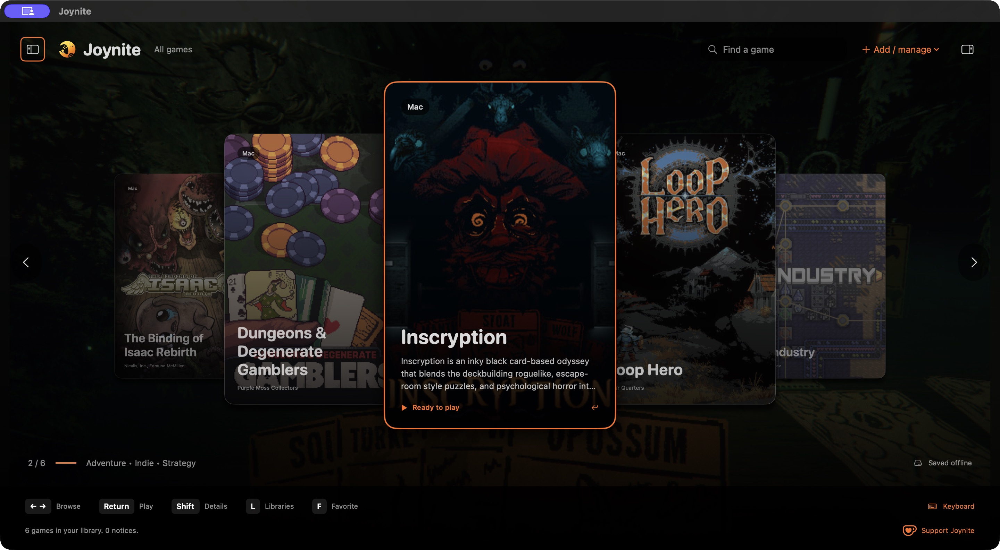
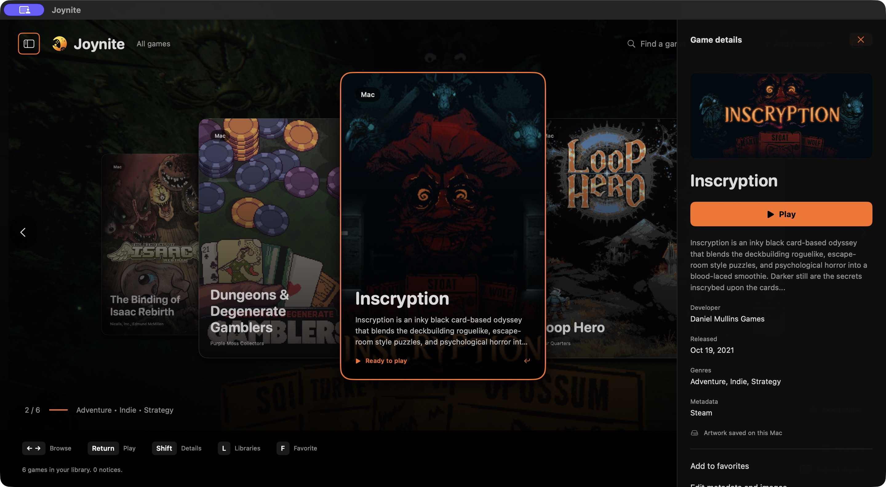
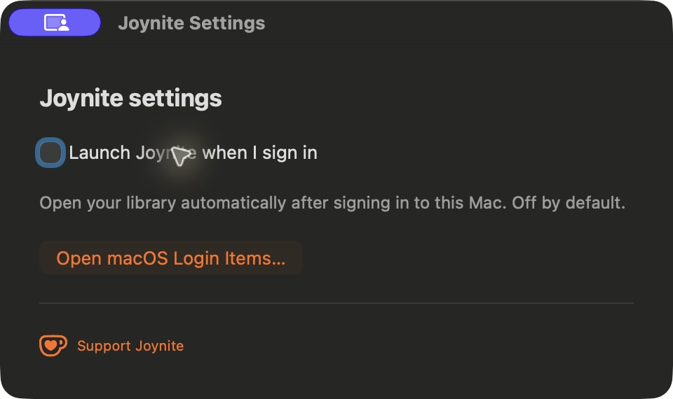

#  Joynite

Your games. One smooth carousel.

Joynite is a redesigned, lightweight game library and launcher with a black-and-orange interface, persistent offline metadata, custom artwork, and keyboard/controller navigation. Choose the native SwiftUI edition for macOS or the Rust/system-webview edition for Windows, Linux, and macOS.

**[Download Joynite](https://github.com/joy-arz/Joynite/releases)** · **[macOS guide](macos/README.md)** · **[Windows/Linux guide](desktop/README.md)** · **[Support on Ko-fi](https://ko-fi.com/joyarz)**

## Your library, front and center



Five cards wrap continuously. The selected game is largest and centered, with its title and description inside the card. Interruptible sliding follows rapid input. Separate portrait covers, inspection images, and alternate backgrounds fit completely over a matching softened fill.



## Features

- **Offline first.** Descriptions, developers, genres, dates, favorites, and artwork remain on disk across restarts. Custom text and three independent image overrides survive automatic refresh.
- **Automatic metadata.** Steam, GOG, itch.io, Epic/store-page matching, and bundled publisher metadata for Roblox, VALORANT, Genshin Impact, and more. Provider availability varies.
- **Installed-game discovery.** Steam, Epic/Heroic manifests, native game applications, and Steam inside Wine, CrossOver, and Sikarugir/Wineskin prefixes. Each compatibility installation keeps its original runtime and prefix.
- **Direct controls.** Arrow keys or A/D browse. Enter/Return launches immediately. Shift toggles details; L toggles libraries. Both sidebars start hidden. Hints follow the active keyboard or controller.
- **Launch at login.** An optional setting opens Joynite when you sign in on Windows, Linux, or macOS. It is off by default.
- **Safer uninstall.** Confirmed native application removal uses Trash. Steam and other stores use their original uninstall flow; metadata remains until removal is confirmed. Disconnected disks do not trigger cleanup.
- **Small implementation.** Native SwiftUI or Rust plus the system webview; no bundled browser or Node runtime. [Measurements and validation limits](AUDIT.md) describe what has actually been checked.

## Settings



Open **Settings** in the app. On macOS, use **Joynite → Settings…** or Command-comma. The shared desktop edition also has a footer Settings button and Command/Ctrl-comma. Enable **Launch Joynite when I sign in** to opt in; disable it to remove the startup registration. A desktop session must be signed in before the app can open.

Existing libraries from this fork’s previous Playnite-branded releases are copied into the Joynite data directory on first launch. Metadata, cached images, favorites, custom overrides, and history stay intact. Original data remains available as a recovery copy. The native and shared Mac editions keep separate library directories.

## Build

Native macOS:

```sh
swift run --package-path macos JoyniteValidation
macos/scripts/build-app.sh --install
```

Shared desktop, after installing the [Tauri prerequisites](https://v2.tauri.app/start/prerequisites/):

```sh
cd desktop
npm ci
npm test
npm run tauri -- build
```

See the platform guides for compatibility limits. Discovery and metadata do not make a Windows-only game or its anti-cheat work on another operating system. Mac preview builds are ad-hoc signed rather than notarized. Original Windows Playnite plugins and themes are not portable to these interfaces.

## Support Joynite

[ **Support joy-arz on Ko-fi**](https://ko-fi.com/joyarz)

If Joynite makes your library easier to use, you can support its development. The same orange Ko-fi cup is available in the app’s bottom-right corner.

## Contributor

**[joy-arz](https://github.com/joy-arz)** — Joynite maintainer and contributor.

Joynite builds on [Playnite](https://github.com/JosefNemec/Playnite) by Josef Nemec and its original contributors. Their source history and MIT license notices remain intact. The original project’s README is preserved in [docs/UPSTREAM-README.md](docs/UPSTREAM-README.md).
